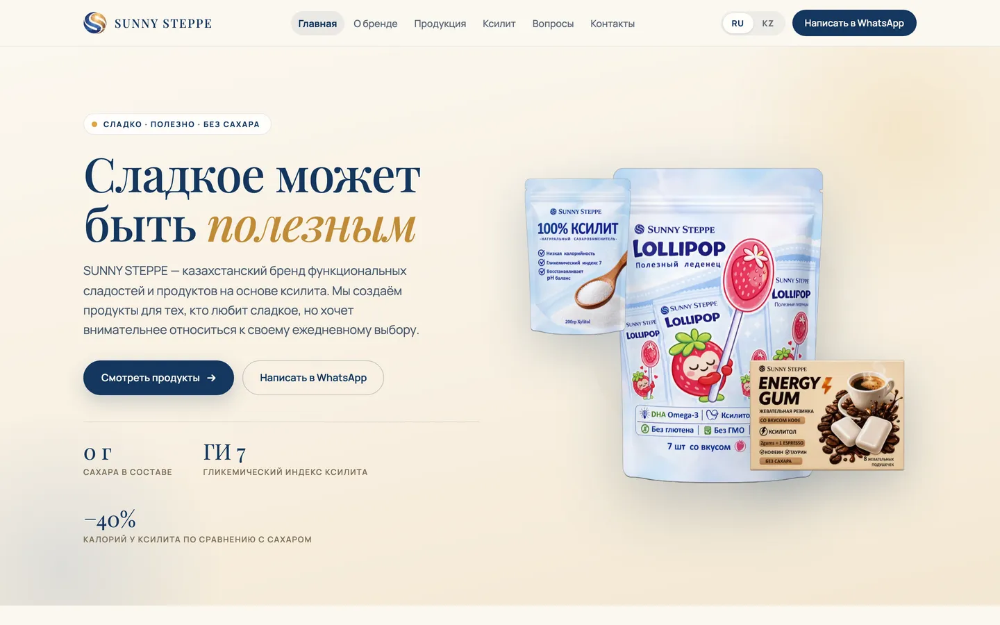
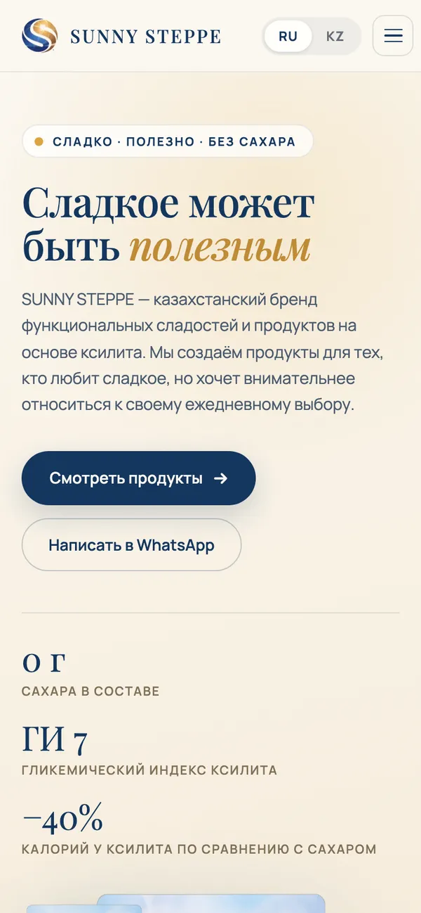
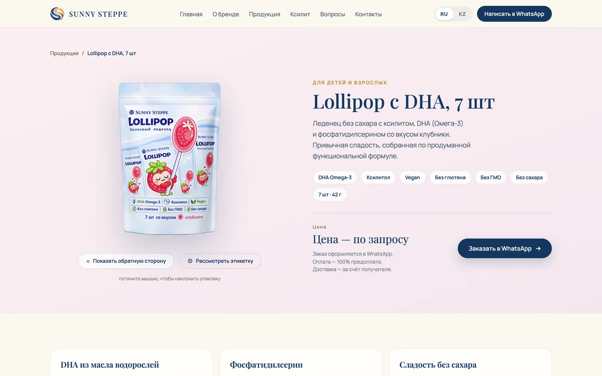
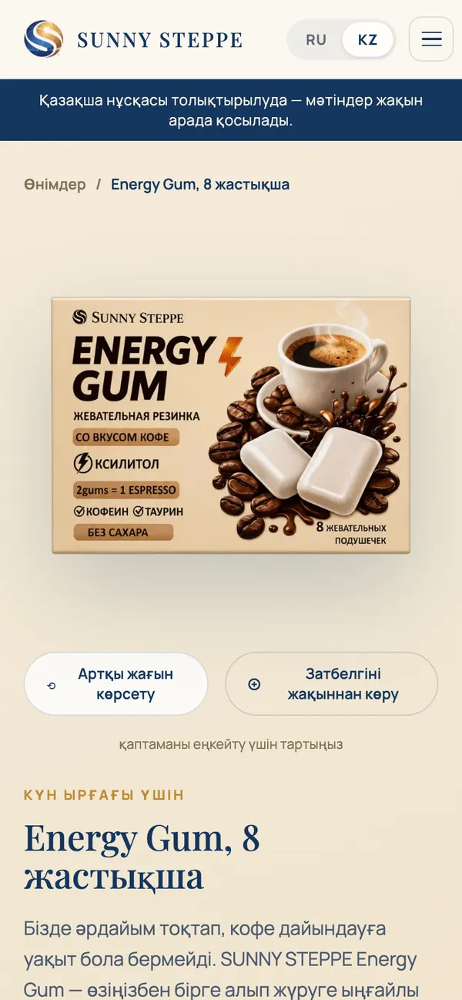

# Sunny Steppe

A bilingual showcase website for a Kazakhstani brand of sugar-free, xylitol-based sweets.
Visitors learn about the products, check their ingredients and EAEU declarations of conformity,
and place an order through WhatsApp.

[](https://github.com/protzzz/sunny-steppe-astro-website/actions/workflows/ci.yml)


**Domain:** [sunnysteppe.kz](https://sunnysteppe.kz) · **Languages:** Russian (site root) and Kazakh (`/kz/`)

<p>
  
  
</p>
<p>
  
  
</p>

## About the project

**Sunny Steppe** sells three sugar-free products: 100% xylitol for home use, Lollipop candies with DHA (omega-3)
and Energy Gum with caffeine. The brand needed a website that:

- **explains the product:** what xylitol is, how it compares to sugar, and what each product contains;
- **builds trust:** EAEU declarations of conformity are published on the site, and every product page shows
  its composition and the facts printed on the packaging;
- **leads to an order:** there is no online shop, the brand sells through WhatsApp, so every "Order" button opens
  a chat with the right number;
- **speaks two languages:** complete Russian and Kazakh versions, with a language switch that keeps the visitor
  on the same page.

The copy was audited sentence by sentence against the owners' documents, the packaging and the declarations.
For food products this matters: marketing or health claims without a source do not go on the site.

## Features

- **11 pages per language:** home, catalogue, three product pages, an article about xylitol, about the brand,
  FAQ, documents, contacts and a privacy policy, plus a bilingual 404 page.
- **Interactive packaging:** the pack can be tilted with the mouse or a finger, turned to the back side
  and zoomed in to read the label.
- **Calculators:** "Xylitol vs sugar" shows the calories saved per year when sugar is replaced;
  the Energy Gum counter converts gum pieces into cups of espresso by caffeine content.
- **Documents:** the EAEU declaration PDFs can be opened or downloaded on product pages, on the Documents page
  and in the FAQ.
- **Language switch:** a single RU/KZ toggle that keeps the current page (`/catalog/` ↔ `/kz/catalog/`).
- **SEO:** `canonical`, `hreflang` (ru / kk / x-default), Open Graph and Twitter cards with 1200×630 share images
  generated at build time, schema.org structured data (`Organization`, `WebSite`), `sitemap-index.xml`
  and `robots.txt`.
- **Performance:** fully static HTML; JavaScript is loaded only for interactive islands, mostly lazily.
  Images are converted to AVIF/WebP in the needed sizes at build time, and fonts are served from the site's
  own domain.
- **Accessibility:** keyboard navigation (skip link, Escape closes the menu), visible focus, `aria` attributes,
  `prefers-reduced-motion` support and text colours chosen for WCAG AA contrast. Every page is checked
  with axe-core in the test suite.
- **Privacy-friendly analytics:** Google Analytics 4 loads only after the visitor accepts the cookie banner
  (see [Analytics](#analytics-google-analytics-4)).

## Tech stack

| Technology                                      | Why                                                                                                                                                                                        |
| ----------------------------------------------- | ------------------------------------------------------------------------------------------------------------------------------------------------------------------------------------------ |
| [Astro 7](https://astro.build)                  | A content site without accounts or a cart. Astro outputs ready HTML and ships JavaScript only where it is needed ([islands architecture](https://docs.astro.build/en/concepts/islands/)).  |
| [React 19](https://react.dev)                   | Only for stateful islands: header menu, 3D pack viewer, calculators, FAQ. Each island hydrates as late as possible (`client:idle` / `client:visible`; the pack viewer uses `client:load`). |
| [Tailwind CSS 4](https://tailwindcss.com)       | Design tokens (brand colours, breakpoints, animations) live in one `@theme` block in `global.css`.                                                                                         |
| TypeScript (strict)                             | The shape of the Russian dictionary is the type of the Kazakh one, so a missing or extra translation key fails before the build.                                                           |
| Astro Assets + Fonts API · sharp                | AVIF/WebP with `srcset`; self-hosted Playfair Display and Manrope; share images and site icons generated with sharp.                                                                       |
| Vitest · Playwright · axe-core                  | Unit tests for the logic, browser tests on desktop and mobile, accessibility checks.                                                                                                       |
| ESLint · Prettier · GitHub Actions · Dependabot | Consistent code style, CI on every push and pull request, scheduled dependency updates.                                                                                                    |

## How it is built

```text
src/
├── pages/[...lang]/      pages; each one is built for Russian (root) and Kazakh (/kz/)
│   └── product/[id]      product pages generated from data/products.ts
├── pages/og/[name].jpg   1200×630 share images, generated at build time
├── pages/robots.txt      robots.txt built from the site URL
├── layouts/Default       <head> with SEO markup, header, footer, cookie banner
├── components/           .astro: static blocks, .tsx: React islands
├── data/                 contacts, products, declarations, navigation
├── i18n/                 ru.ts and kz.ts dictionaries and how they are combined
├── lib/                  analytics and structured-data logic (unit-tested)
├── assets/               logo and pack shots (optimised at build time)
└── styles/global.css     Tailwind theme
public/                   declaration PDFs, site icons, web manifest, .htaccess
scripts/                  build check, icon generator, Kazakh word list
tests/unit, tests/e2e     Vitest and Playwright
```

A few design decisions worth noting:

- **Content is separate from markup.** Templates contain no visitor-facing text. Copy lives in the dictionaries;
  products and declarations live in `src/data/`.
- **Kazakh on top of Russian.** `kz.ts` holds only the translated keys and is merged over `ru.ts`. A missing
  translation does not break the site, but the build check reports it (see below).
- **Contacts in one place.** The copy uses placeholders such as `{phone}` and `{deliveryTerms}`. Their values come
  from `src/data/contacts.ts` at build time, so changing the phone number updates every page. A missing phone
  number stops the build instead of printing "undefined".
- **One source for the site URL.** The domain comes only from `PUBLIC_SITE_URL`; canonical links, the sitemap,
  `robots.txt`, share images and structured data are all built from it.

## Quality and automation

**Build check** (`scripts/check-build.mjs`) runs after every build, without a browser, and fails if:

- an internal link, image or `og:image` points to a missing file;
- Russian text is left on a Kazakh page (words that the client's Kazakh translation also uses, such as
  "ксилит", are allowed);
- `gtag.js` is loaded directly in the page HTML instead of after consent;
- any absolute URL (canonical, hreflang, Open Graph, sitemap, `robots.txt`, structured data) points to a domain
  other than `PUBLIC_SITE_URL`.

It also warns about images over 400 KB and prints the site URL and the GA4 status to the build log.

**Unit tests** (Vitest, `tests/unit`) cover dictionary merging and placeholder filling, link building
(no `/ru` prefix, trailing slash), Russian plural forms, product and declaration data, the analytics logic
(link classification, consent storage and expiry, GA ID validation) and the structured data.

**Browser tests** (Playwright, `tests/e2e`) run on two devices: desktop 1280×800 and mobile 360×740.

- **Site crawl.** Pages are not listed by hand: the tests find them by following links from `/` and `/kz/`,
  so a new page is tested automatically. Against the build, the crawl is compared with `dist/` to catch
  pages that nothing links to.
- **Every page, both languages:** HTTP 200, no console errors or failed requests, correct `lang`, title and
  description, every image loaded and with `alt`, no horizontal scrolling, no unfilled placeholders,
  trailing-slash links, valid WhatsApp links, `rel="noopener"` on new-tab links, one JSON-LD block,
  a language switch that keeps the page, and no requests to Google.
- **Interaction:** mobile menu (including Escape and the WhatsApp button), the language switch clicked
  on every page, FAQ, turning the pack, both calculators.
- **Links and routing:** every PDF returns 200, `/` is the Russian home page and `/kz/` the Kazakh one,
  pages load without redirects, unknown URLs return the 404 page.
- **Accessibility:** every page in both languages passes axe-core without serious or critical violations.
- **Analytics:** no request to Google before consent while links still open; after consent on the production
  domain `gtag.js` loads and the three events are sent with their parameters; withdrawing consent stops tracking
  and removes the cookies; nothing is sent from `localhost`. Google is not needed: its requests are intercepted.
- **Content-Security-Policy:** every page is loaded with the CSP from `public/.htaccess`; the test fails on any
  violation, so a new script or font cannot be blocked unnoticed on the hosting.

**CI** (`.github/workflows/ci.yml`) runs on every push to `master`, on every pull request and manually
("Run workflow" in the Actions tab): Prettier → ESLint → `astro check` → `tsc` → unit tests → build →
build check → Playwright. When a test fails, the HTML report and traces are uploaded as an artifact.

**Dependabot** opens one pull request a week for npm minor and patch updates and separate ones for major
versions; GitHub Actions are updated monthly. TypeScript 7 is skipped for now because `astro check`
and `typescript-eslint` do not support it yet.

## Getting started

Requires Node.js 22.12 or newer.

```sh
npm install
cp .env.example .env # site URL
npm run dev          # http://localhost:4321
```

**Environment variables** (`.env` is not in git; see `.env.example`):

| Variable          | Purpose                                                                                                                                |
| :---------------- | :------------------------------------------------------------------------------------------------------------------------------------- |
| `PUBLIC_SITE_URL` | Required. The site address, a bare `https://` origin. Canonical links, hreflang, Open Graph, the sitemap and `robots.txt` use it       |
| `PUBLIC_GA_ID`    | Google Analytics 4 Measurement ID (`G-…`). Set it only in the hosting's production build; keep it empty locally                        |
| `PUBLIC_NOINDEX`  | `true` for a test copy of the site: `noindex` on every page and `Disallow: /` in `robots.txt`. Empty in production                     |
| `FTP_*`           | Credentials for uploading `dist/` to the hosting (ps.kz). Not read by the site. In GitHub, store them under **Secrets**, not Variables |

In CI the site URL comes from the repository variable `SITE_URL`, falling back to `https://sunnysteppe.kz`.
Never prefix secrets with `PUBLIC_`: Astro writes such values into the pages.

After each build, `check-build` prints which site URL and GA4 ID the site was built with:

```text
Site URL: https://sunnysteppe.kz (canonical, hreflang, og, sitemap, robots.txt)
GA4: G-XXXXXXXXXX, loads only on sunnysteppe.kz after consent
```

All internal links end with `/` (`trailingSlash: "always"`), matching how the pages are built in `dist/`,
so the hosting serves them without an extra redirect. Links are always built with `localePath()`.

### Security headers

`public/.htaccess` is copied to the root of `dist/`. It sets a Content-Security-Policy, `X-Content-Type-Options`,
`X-Frame-Options`, `Referrer-Policy` and `Permissions-Policy`, caches the hashed files in `/_astro/` for a year
and serves the custom 404 page. It works when Apache runs behind nginx (the Plesk default); in "nginx only" mode
the same headers have to be set in the domain's Apache & nginx settings. HSTS is commented out until HTTPS
is live on the domain.

### Analytics (Google Analytics 4)

- **Consent first (basic Consent Mode).** Until the visitor clicks "Разрешить" (Allow) in the banner, `gtag.js` is not loaded
  and nothing is sent to Google. The choice is stored in the browser for 6 months; "Настройки cookies" (Cookie settings) in the
  footer lets visitors change it, and declining stops tracking at once and removes the `_ga*` cookies. WhatsApp, Instagram
  and PDF links work either way.
- **Where it is off.** `astro dev` contains no analytics code. A build without `PUBLIC_GA_ID` has no banner and
  no script. `gtag.js` is requested only on the `PUBLIC_SITE_URL` domain, never on `localhost`, hosting previews
  or in tests.
- **Events:** `whatsapp_click`, `pdf_download` and `instagram_click`, with `link_location` (header, menu, footer,
  hero, product, product_cta, contacts, documents, catalog, content), `lang`, `product`, `file_name`, `link_type`
  (open / download) and `link_url`. New WhatsApp, Instagram or PDF links are tracked automatically.
- **Code:** `src/lib/analytics.ts` (logic, unit-tested) and `src/components/ConsentBanner.astro` (banner and
  browser code). Tests: `tests/e2e/analytics.spec.ts`; the site is built for them with a fake `G-TEST000000`.
- **Privacy policy** (`/privacy/`, `/kz/privacy/`) is a **draft**: the site owners, and a lawyer if needed,
  must review it before launch. The Kazakh text is ours and still needs a translator's check.

### Commands

| Command                    | What it does                                                                                                                           |
| :------------------------- | :------------------------------------------------------------------------------------------------------------------------------------- |
| `npm run dev`              | Dev server at `localhost:4321`                                                                                                         |
| `npm run build`            | `astro check`, build into `dist/`, then `scripts/check-build.mjs`                                                                      |
| `npm run preview`          | Serve the built site locally                                                                                                           |
| `npm run check`            | Type checks only: `astro check` and `tsc --noEmit`                                                                                     |
| `npm run lint`             | ESLint                                                                                                                                 |
| `npm run format`           | Prettier (`npm run format:check` only checks)                                                                                          |
| `npm run icons`            | Site icons (`favicon.ico`, `apple-touch-icon.png`, `icon-192.png`) from `src/assets/logo-mark.png`. No 512 px icon: the logo is 213 px |
| `npm test`                 | Unit tests, build and browser tests on the build: the same checks as CI                                                                |
| `npm run test:unit`        | Unit tests only (Vitest, `tests/unit`)                                                                                                 |
| `npm run test:e2e`         | Browser tests (Playwright, `tests/e2e`): builds the site and serves it with `astro preview`                                            |
| `npm run test:e2e:dev`     | The same tests on `astro dev`. Local only: catches problems that appear only on the dev server                                         |
| `npm run test:e2e:running` | The same tests on an already running `astro dev` at `localhost:4321`                                                                   |

### More on browser tests

Install the browser once before the first run: `npx playwright install chromium`.

- Test the live site: `BASE_URL=https://sunnysteppe.kz npx playwright test`.
- One file or one device: `npx playwright test tests/e2e/interactive.spec.ts --project=mobile`.
- `E2E_STRICT_TODO=1` fails the run if "TODO" lines are left on `/kz` pages; by default they are listed
  as warnings at the end.
- **Report:** `npx playwright show-report` opens the HTML report with every step and failure screenshots.
- **Trace of a failed test:** `npx playwright show-trace test-results/<test>/trace.zip` shows every action,
  the DOM before and after, the console and the network.

## Updating content

| What to change                      | Where                                                               |
| :---------------------------------- | :------------------------------------------------------------------ |
| Phone, WhatsApp, email, delivery    | `src/data/contacts.ts`                                              |
| Products: copy, composition, photos | `src/data/products.ts`, `src/assets/products/`                      |
| EAEU declarations                   | `src/data/documents.ts` + PDF in `public/docs/`                     |
| Page copy                           | `src/i18n/ru.ts` and `src/i18n/kz.ts` (add every key to both files) |

Detailed rules for developers and AI assistants (conventions, pitfalls, step-by-step recipes) are in
[`AGENTS.md`](AGENTS.md).

## Author

Development: [@protzzz](https://github.com/protzzz).
Copy, packaging photos and documents belong to the Sunny Steppe brand.
